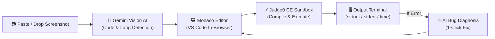

# 🔍 CodeLens — Turn Screenshots into Runnable Code

<p align="center">
  
  
  
  
  
  
</p>

**CodeLens** is a modern developer web application that converts code from screenshots, tutorial videos, lecture slides, and social media into editable, runnable code in an online compiler interface. 

Powered by **Google Gemini Vision AI**, CodeLens reconstructs clean, syntax-accurate source code with preserved indentations, automatically detects the programming language, loads it into the browser's **Monaco Editor** (VS Code engine), and executes it instantly across 12+ programming languages.

---

## 🌟 Key Features

- **📷 Instant Screenshot to Code (OCR & AI Reconstruction)**:
  - Paste directly from your clipboard (`Cmd+V` / `Ctrl+V`) or drag & drop screenshots.
  - Automatically fixes common OCR glitches (indentations, curly quotes, semicolon errors).
  - Auto-detects the programming language.
- **💻 VS Code-Grade Monaco Editor**:
  - Full syntax highlighting, line numbers, bracket matching, and auto-indentation.
  - 1-click **Copy Code** and **Save/Download** as a source file (`.py`, `.cpp`, `.js`, etc.).
  - Fullscreen expansion mode for deep coding sessions.
- **⚡ Fast Multi-Language Sandbox Compiler**:
  - Compiles and runs **Python, C++, C, JavaScript, TypeScript, Java, Go, Rust, Ruby, PHP, Swift, and Kotlin**.
  - Sub-second execution speeds powered by isolated sandbox environments.
  - Displays runtime duration (ms), memory usage, exit codes, and output.
- **⌨️ Interactive Standard Input (`stdin`)**:
  - Full support for interactive programs using `input()` in Python or `cin >>` in C++.
- **✨ Built-in AI Superpowers**:
  - **Fix Bug with AI**: If your code encounters a compilation or runtime error, click 1 button to diagnose the root cause and apply the fix to the editor.
  - **Explain Code**: Generates concise, step-by-step educational breakdowns along with Big-O Time & Space complexity.
  - **Language Converter**: Convert code from one language to another (e.g. Python $\rightarrow$ C++).
- **🔒 Privacy First**:
  - API keys are stored only in your local browser storage (`localStorage`) and never sent to external tracking servers.

---

## 🏗️ Architecture



---

## 🚀 Quickstart Guide

### Prerequisites
- [Node.js](https://nodejs.org/) (v18 or newer)
- npm or pnpm or yarn
- *(Optional)* Free [Google Gemini API Key](https://aistudio.google.com/app/apikey)

### 1. Clone the repository
```bash
git clone https://github.com/<your-username>/search-code.git
cd search-code
```

### 2. Install dependencies
```bash
npm install
```

### 3. Run development server
```bash
npm run dev
```

Open [http://localhost:3000](http://localhost:3000) in your browser.

---

## 🔑 Getting Your Free Gemini API Key

1. Go to [Google AI Studio](https://aistudio.google.com/app/apikey).
2. Sign in with your Google account.
3. Click **"Create API Key"** (100% free with generous rate limits).
4. In **CodeLens**, click the **Settings** gear in the top right and paste your key.

*(Alternatively, you can create a `.env.local` file in the project root and add `GEMINI_API_KEY=your_key_here`).*

---

## 🌐 Deploy to Vercel (1-Click)

The simplest way to deploy your own live version of CodeLens for free:

1. Push your repository to GitHub.
2. Go to [Vercel](https://vercel.com/) and click **"Add New Project"**.
3. Import your `search-code` repository.
4. *(Optional)* Under **Environment Variables**, add:
   - `GEMINI_API_KEY` = your Gemini API key.
5. Click **Deploy**. Your site will be live on an HTTPS URL in ~1 minute!

---

## 🛠️ Supported Languages

| Language | Engine Version | Extension |
| :--- | :--- | :--- |
| **Python 3** | Python 3.12.5 | `.py` |
| **C++** | GCC 14.1.0 | `.cpp` |
| **C** | GCC 14.1.0 | `.c` |
| **JavaScript** | Node.js 20.17 | `.js` |
| **TypeScript** | TypeScript 5.6 | `.ts` |
| **Java** | OpenJDK 17.0 | `.java` |
| **Go** | Go 1.23.5 | `.go` |
| **Rust** | Rust 1.85.0 | `.rs` |
| **Ruby** | Ruby 2.7.0 | `.rb` |
| **PHP** | PHP 8.3.11 | `.php` |
| **Swift** | Swift 5.2.3 | `.swift` |
| **Kotlin** | Kotlin 2.1.10 | `.kt` |

---

## 📄 License

MIT License. Free to use, modify, and build upon.
